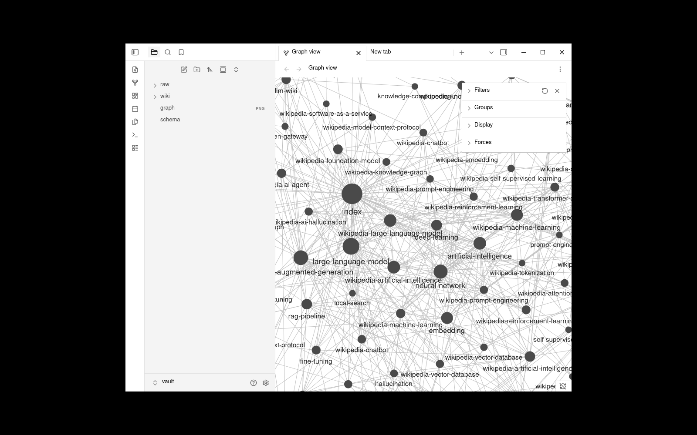
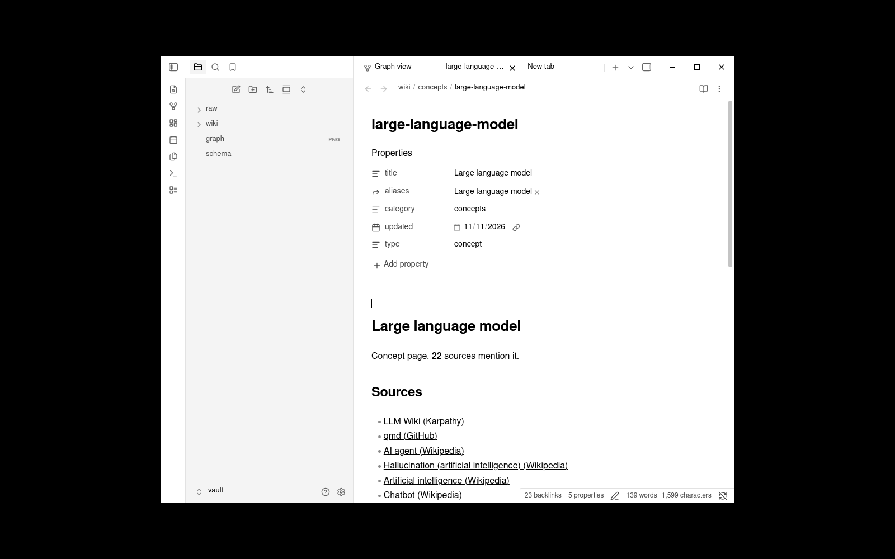
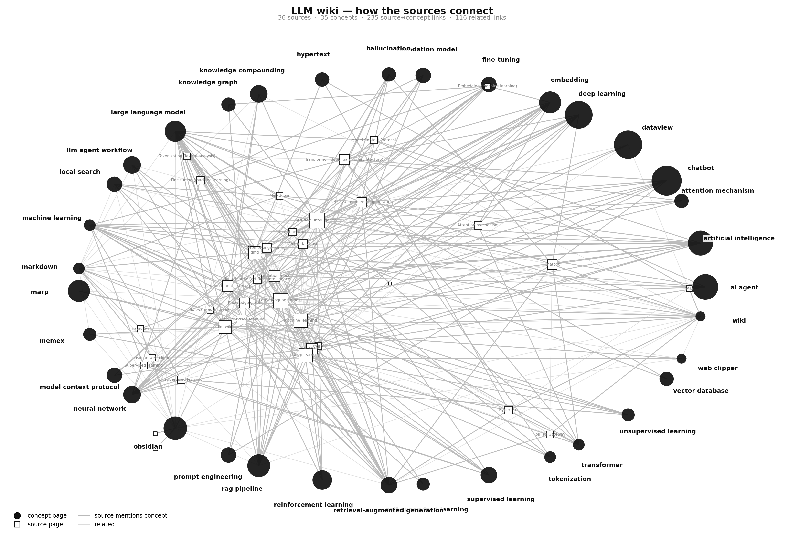

# LLM Wiki — AI knowledge vault

A working [Karpathy-style LLM wiki](https://gist.github.com/karpathy/442a6bf555914893e9891c11519de94f)
built from scratch: raw AI sources in, a cross-linked wiki out — and rendered in the
**Obsidian Clone** (the monochrome Obsidian 1.15.0 rebuild in this workspace).

| Obsidian clone — graph view | Obsidian clone — concept page |
| --- | --- |
|  |  |

## The pattern

Karpathy's idea file describes three layers:

| Layer | Where | Who writes it |
| --- | --- | --- |
| **Raw sources** | `vault/raw/` | nobody — immutable |
| **The wiki** | `vault/wiki/` | the agent |
| **The schema** | `vault/schema.md` | humans + agent |

Operations are *ingest* (read a source → update its page, the concept pages it touches,
the index, the log), *query* (read `index.md` → drill into concept pages → cite sources)
and *lint* (find contradictions, stale claims, orphan pages).

## What is in it

```
36 sources      27 Wikipedia AI articles + 9 tooling/idea documents
35 concepts     the ideas the sources talk about (the hubs of the graph)
235 source ↔ concept links
94  source ↔ source links
134 resolved links, 0 unresolved
```

Hubs, measured from the vault itself: **Artificial intelligence** (32 inbound),
**Large language model** (31), **Deep learning** (27), **Machine learning** (25),
**wiki** (12), **embedding** (10).

### The connection map



Concepts sit on the ring, sources inside it. The dense core is the AI stack
(artificial intelligence ↔ large language model ↔ deep learning ↔ neural network);
the outer ring is the wiki tooling the idea file leans on (Obsidian, Markdown,
hypertext, Marp, Dataview, local search, memex).

## Layout

```
vault/
  raw/                    60 immutable sources (Wikipedia extracts, READMEs, the idea file)
  wiki/
    index.md              content-oriented catalog
    log.md                chronological log (grep "^## \[" log.md | tail -5)
    sources/*.md          one page per source: summary, key terms, concepts, related
    concepts/*.md         one page per concept: the sources that mention it, related concepts
  schema.md               the agent contract (structure, conventions, workflows)
  graph.json              machine-readable graph of the whole vault
scripts/
  fetch_wikipedia.py      pull AI articles from the Wikipedia API
  fetch_articles.py       pull the idea file and the tooling docs
  build_wiki.py           raw -> wiki (summaries, concept pages, index, log, schema, graph.json)
  render_graph.py         graph.json -> connection-map.png (barycentric concept map)
  wiki-actions.mjs        drive the Obsidian clone over CDP (open pages, graph view, status)
  graph-fit.mjs           fit/zoom the clone's graph view for capture
```

## Rebuild it

```bash
python3 scripts/fetch_wikipedia.py vault/raw
python3 scripts/fetch_articles.py  vault/raw
python3 scripts/build_wiki.py vault --raw raw --only-seeded
python3 scripts/render_graph.py vault --out screenshots/connection-map.png
```

## Open it in the Obsidian clone

```bash
cd ../obsidian-clone
HOME=/tmp/wiki-home DISPLAY=:99 OBSIDIAN_CLONE_USER_DATA=/tmp/wiki-home/.config/obsidian \
  OBSIDIAN_CLONE_DISABLE_UPDATE=1 ./clone/obsidian --no-sandbox --remote-debugging-port=9260 &

# then, from this directory:
node scripts/wiki-actions.mjs --cdp http://127.0.0.1:9260 graph
node scripts/wiki-actions.mjs --cdp http://127.0.0.1:9260 open "wiki/index.md"
```

## Two Obsidian details worth knowing

1. **Links resolve by file basename, not by `aliases`.** Obsidian 1.15 does not use the
   `aliases` frontmatter array for link resolution, so every cross-reference is written
   as `[[basename|display title]]`.
2. **Display names must be unique case-insensitively.** A concept named
   `artificial intelligence` and a source named `Artificial intelligence` make *both*
   links ambiguous and neither resolves — hence `Artificial intelligence (Wikipedia)`
   for sources.

Both were found by measuring the vault in the running app
(`app.metadataCache.resolvedLinks` / `unresolvedLinks`), not by guessing.

## Source of the pattern

`raw/llm-wiki.md` — Karpathy, *LLM Wiki: A pattern for building personal knowledge
bases using LLMs*. The wiki tooling documents (Obsidian, Marp, Dataview, qmd, the Web
Clipper) are the ones that idea file names.
