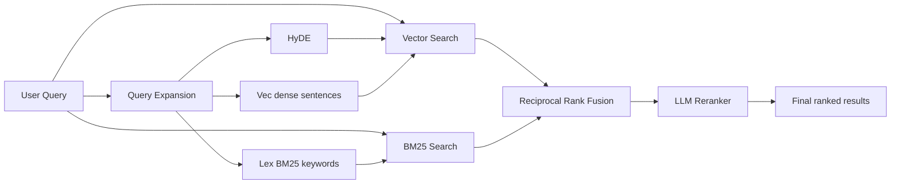

# qmd (GitHub)

> Raw source: https://raw.githubusercontent.com/tobi/qmd/main/README.md
> Immutable source document — the wiki summarises it, it never edits it.

## Summary

An on-device search engine for everything you need to remember. Index your markdown notes, meeting transcripts, documentation, and knowledge bases. Search with keywords or natural language. Ideal for your agentic flows.

QMD combines BM25 full-text search, vector semantic search, and LLM re-ranking—all running locally via node-llama-cpp with GGUF models.



Typed expansions are routed exclusively: `lex` → BM25/FTS, `vec` and `hyde` → vector search. The original query is sent to both backends, then fused with RRF and reranked.

```sh
# Insta

## Key terms

`collection`, `search`, `query`, `metadata`, `value`, `notes`, `default`, `operator`

## Concepts

- [[rag-pipeline|RAG pipeline]]
- [[embedding|Embedding]]
- [[model-context-protocol|Model Context Protocol]]
- [[local-search|Local search]]
- [[large-language-model|Large language model]]
- [[retrieval-augmented-generation|Retrieval-augmented generation]]

## Related sources

- [[llm-wiki|LLM Wiki (Karpathy)]]
- [[wikipedia-ai-agent|AI agent (Wikipedia)]]
- [[wikipedia-knowledge-graph|Knowledge graph (Wikipedia)]]
